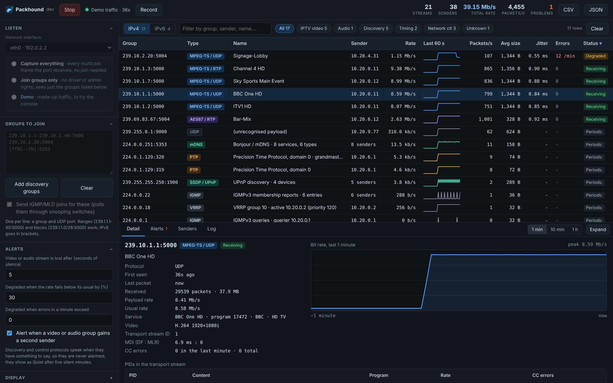
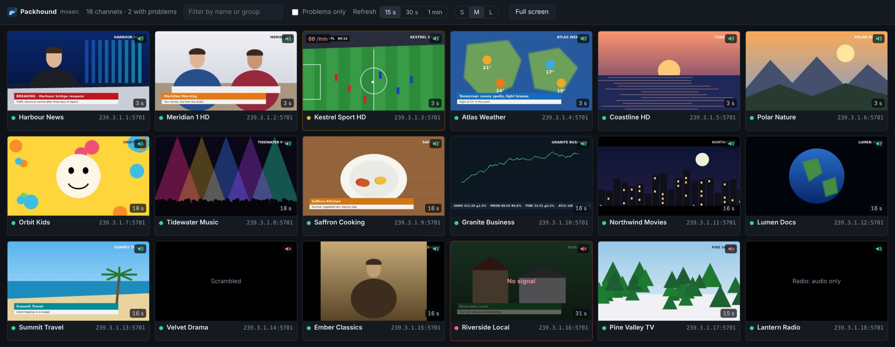

# Packhound

Sniffs out every multicast stream arriving at a network port and tells you what
it is, how fast it runs, who is sending it and whether it is healthy: IPTV
channels, AES67 audio, mDNS, SSDP, PTP, IGMP and the rest of a network's
chatter. A mosaic shows a live still of every TV channel, with its state and
whether its audio is arriving. One binary, no installer, a console in your
browser; or a virtual appliance that watches your channels around the clock
and answers SNMP and a REST API.

> Author: Andrea Coppini · Feedback: <andrea@tacoppini.com>



## Download

Get the file for your platform from the
[latest release](https://github.com/andreacoppini/packhound/releases/latest):

| Platform | File |
|---|---|
| Windows | `packhound-windows-amd64.exe` (`-arm64` for Surface and Snapdragon), or the `.zip` of the same file for networks that block `.exe` downloads |
| macOS | `packhound-macos.zip`, one universal binary for Intel and Apple Silicon |
| Linux | `packhound-linux-amd64.tar.gz` (or `-arm64`) |
| Virtual appliance | `packhound-appliance-<version>.ova` (VMware, VirtualBox), `.qcow2` (Proxmox, KVM) or `-hyperv.zip` (Hyper-V): see [The appliance](#the-appliance) |

The binaries are unsigned, so Windows and macOS warn on first launch. On macOS
run `xattr -d com.apple.quarantine packhound-macos-universal` once, or
right-click and Open. `SHA256SUMS.txt` in the release covers every file, and
every binary is built by [GitHub Actions](.github/workflows/release.yml) from
the tagged commit.

To build it yourself you need only Go: `go build .`

## Using it

Run it with no arguments, or double-click it, and it opens the console in your
browser, bound to this machine only:

```
Packhound 1.0.0
Console: http://127.0.0.1:52413
```

Pick the interface, choose how to listen, press **Listen**. Choose **Demo** to
see the console working with made-up traffic and no network at all. To look
at traffic captured elsewhere, use **Open capture…** instead (see
[Capture files](#capture-files)); to watch a switch you are not plugged
into, see [Remote switches](#remote-switches-erspan-and-tzsp).

### Two ways to listen

| | Capture everything | Join groups only |
|---|---|---|
| Sees | every multicast frame the port receives, including IGMP, VRRP, PIM, MLD and other non-UDP protocols | only the groups you list, and only their UDP payloads |
| Needs | **Linux:** root, or `sudo setcap cap_net_raw,cap_net_admin+ep ./packhound` once<br>**macOS:** root, or Wireshark's ChmodBPF helper<br>**Windows:** [Npcap](https://npcap.com) (free) | nothing: no driver, no admin rights |
| Puts the interface in | all-multicast mode (Linux) or promiscuous mode (macOS, Windows) | its normal state |

If capture is not available, Packhound says why and falls back to joining the
listed groups.

**Capture does not make the switch send you anything.** On a switch with IGMP
snooping, a group only reaches your port if something on that port has joined
it. That is what the *Groups to join* list is for: in capture mode, Packhound
also joins the groups listed there, so you can pull an IPTV channel to the port
and watch it. Link-local groups (224.0.0.x, ff02::) and anything the switch
floods arrive regardless.

Groups are listed one per line as a group and UDP port. Ranges and blocks
work, and IPv6 goes in brackets:

```
239.10.1.1-239.10.1.40:5000
239.10.1.1-40:5000          # the same range, written short
239.10.2.0/28:5004
[ff02::fb]:5353
```

**Add discovery groups** fills in mDNS, SSDP, WS-Discovery, LLMNR, SAP and PTP.

### What each column means

| Column | |
|---|---|
| Group | the multicast group, and the UDP port where there is one |
| Type | what the traffic is, from the port and the payload (an MPEG-TS sync byte every 188 bytes, an RTP header, a known discovery protocol) |
| Name | the channel name (from the stream's SDT), the AES67 session (from SAP), or a summary (*8 services, 6 types*) |
| Rate | bits per second at the IP layer, which is what the stream costs on the wire; the payload rate is in the detail panel |
| Packets/s, Avg size | per second, and the IP datagram size: 1,344 bytes is seven TS packets over UDP, 1,356 the same over RTP |
| Jitter | how much the gap between packets varies, for video and audio |
| Errors | in the last minute: continuity-counter errors that mean lost packets (MPEG-TS), lost packets (RTP), and datagrams that arrived twice |
| Status | **Receiving**, **Degraded** (errors, or a rate well below its usual), **Lost** (silent for longer than the alert setting), or for protocols that speak when they have something to say, **Periodic** and **Quiet** |

Click a row for its detail: a rate graph over the last minute, ten minutes or
hour, and what the protocol says.

- **IPTV:** each programme's name, provider and type; the PIDs with their
  content, language and rate; the picture size read from the H.264 stream;
  continuity errors per PID; the Media Delivery Index (delay factor and loss
  rate, RFC 4445); RTP losses and reordering.
- **Telling real errors from false alarms:** a continuity error is only
  counted as one when packets are actually missing. Many encoders advance the
  counter on packets that carry only a PCR, which the standard forbids but
  every decoder ignores; those are shown separately as *CC quirks (no loss)*.
  A datagram that arrives twice (a loop, or two paths) is counted as
  duplicated rather than as a run of CC errors. If the capturing machine
  itself drops packets because its buffer overflowed, the header says so,
  since the errors it causes are not on the network.
- **Dante:** multicast flows (239.255.x.x, port 4321) named after the device
  that sends them; the PTPv1 clock leader, with its address, device name,
  stratum and sync interval; and the devices and their channels from their
  mDNS announcements. Dante's audio format is its own, so a native flow
  shows rate, packets, jitter and whether it stops, but not channel content;
  a device in AES67 mode shows as AES67, with packet loss. Dante sends audio
  unicast unless a flow is set to multicast, and unicast flows are not
  visible to a multicast monitor.
- **AES67 and RTP audio:** format, packet time and sender, named from SAP.
- **mDNS:** every service announced (AirPlay, Chromecast, printers, Sonos,
  HomeKit and so on) with its host, address and port, and what is being asked
  for.
- **SSDP and WS-Discovery:** devices, their server strings and description URLs.
- **PTP:** the grandmaster, its clock class, accuracy and priority, and the
  message rates.
- **IGMP and MLD:** the elected querier and its interval, and who has joined what.
- **VRRP and HSRP:** the active router, its priority and the virtual addresses;
  two VRRP routers advertising the same group is flagged as a split brain.
- **IPv6 neighbour discovery:** routers advertising, their prefixes and DNS,
  and the addresses being resolved.
- **Anything unrecognised:** the first bytes of the payload.

### Watching a stream

For MPEG-TS streams (marked ▶ in the table), the detail panel has **Open in
VLC**, which starts VLC on this computer playing the stream; double-clicking
the row does the same. **Playlist .m3u** saves a playlist file any player
opens, and **Copy URL** copies the address (`udp://@239.10.1.1:5000`, or
`rtp://@…` for RTP) to paste into a player. VLC joins the group itself, on the
interface the operating system picks for multicast, which is normally the one
with the default route.

IPv6 streams are on their own tab, so the table you care about is not buried
under neighbour discovery.

### Mosaic



**Mosaic** in the header opens, in a new tab, a still of every MPEG-TS
channel, refreshed every 15 seconds, 30 seconds (the default) or minute, as
set by **Refresh** at the top of the page. Each tile shows the channel's name and
group, its state (a red border and "No signal" when it stops, amber when it
degrades), its errors in the last minute, how old the picture is, and a
speaker: green while audio is arriving, red with a cross when the channel has
audio but none is arriving. The speaker says the audio is there, not that it
is not silent. Scrambled channels say so instead of showing a picture.

A still is the next key picture on the channel, copied out of the stream
Packhound already receives, so the mosaic joins nothing extra. ffmpeg decodes
it to a small JPEG, one picture at a time, using at most a quarter of one
core: with more channels than that allows in the interval, a round of stills
simply takes longer. Stills are taken only while someone has the mosaic open
or an API client is reading it. When nothing has asked for a minute (or for
two intervals, when that is longer), it stops, and costs nothing. An API
client that polls less often than that gets the stills as they were when
the mosaic stopped, and its request starts it again.

The refresh interval is shared by everyone looking, and the appliance
remembers it. A wall screen opened with the API token cannot change it.

The appliance includes a small ffmpeg (H.264, HEVC and MPEG-2 only). On
Windows, macOS and Linux, Packhound uses an `ffmpeg` beside it or on the PATH,
or the one named in `PACKHOUND_FFMPEG`; without one, the mosaic shows each
channel's state and audio, but no pictures.

### Alerts

A video or audio stream raises an alert when it stops, when it degrades, when
it recovers, and when a second sender appears on it (usually a misconfigured
encoder or a loop). The thresholds are in the sidebar and apply immediately.
Discovery and control protocols are never alarmed.

### Recording and exporting

**Record** writes the multicast traffic to a `.pcap` file for Wireshark, in your
Downloads folder; stopping the recording downloads it. In capture mode the
frames are written as received; in join mode the socket never saw the headers,
so the frames are rebuilt around the payloads. Recordings stop at 2 GB.

**CSV** and **JSON** download the stream table; JSON includes the alerts.

### Capture files

**Open capture…** analyses a `.pcap` or `.pcapng` file from Wireshark or
tcpdump: Ethernet, `tcpdump -i any` (Linux cooked v1 and v2) and raw IP
captures, up to 4 GB. The file is read on its own clock, as fast as it
loads, into a view of its own, so live monitoring (and on the appliance,
SNMP and the REST API) carries on meanwhile. A banner says which file you
are looking at; **Back to live** returns to the live view.

The result is the state of things when the capture ended:

- Rates are each stream's average over its time in the file, and errors
  are totals for the whole capture.
- Alerts carry the capture's own times, so the alert list is a timeline of
  what went wrong: when a channel stopped, degraded, came back.
- The mosaic shows one still per channel, taken from the file, with the
  time in the capture it is from.
- A capture of a switch's mirror (ERSPAN or TZSP, as it arrives) is
  unwrapped: the mirrored traffic inside is what gets analysed.

The detail chart keeps the last hour of a longer capture. The same works
from the command line, for scripts:

```
packhound -read site.pcapng                     # print the streams and the alert timeline
packhound -read site.pcapng -out streams.json   # and save them
```

### Remote switches (ERSPAN and TZSP)

A switch can mirror a port to Packhound over the network, so the channels
it carries can be watched without a cable to it. Choose **Remote switch**,
pick the interface whose address the switch sends to, and say what the
switch sends:

| Switch | Sends | Packhound needs |
|---|---|---|
| Cisco, Arista, Juniper, Aruba, Ruckus ICX | ERSPAN (GRE): Types I, II and III, or plain GRE bridging | root (administrator on Windows), or else the same access as *Capture everything*: Wireshark's ChmodBPF on macOS, Npcap on Windows, `setcap cap_net_raw` on Linux. The appliance runs as root. |
| MikroTik | TZSP, to UDP port 37008 (the packet sniffer's streaming) | nothing |

Optionally, take the mirror only from one switch's address, or one ERSPAN
session, when several point at the same Packhound. The console shows
configuration examples for each switch with this machine's address filled
in, and the status line says whether the mirror is arriving: frames a
second, and from which switch.

Mirror the **receive** direction of the port only: mirroring both doubles
every datagram, which Packhound reports as duplicated datagrams. A switch
mirrors what crosses the port, so it does not need to join anything; the
mirror does add the mirrored port's traffic to the network path between
the switch and Packhound. Jitter is measured on arrival here, so it
includes that path. MikroTik's sniffer runs on the router's CPU: fine for a
few channels, not for a whole IPTV feed.

From the command line:

```
sudo packhound -i eth0 -mode remote -remote erspan -from 10.0.0.2 -duration 1m
packhound -i eth0 -mode remote -remote tzsp
```

### From the command line

The same engine runs without the console:

```
packhound -list                                   # interfaces, and whether capture works here
packhound -i eth0 -duration 30s -out streams.csv  # listen, print the table, save it
packhound -i "Ethernet 2" -mode join -join 239.10.1.1-40:5000 -duration 1m
packhound -i en0 -join-file channels.txt -start   # console, already listening
packhound -read capture.pcapng -out streams.json  # analyse a capture file
packhound -i eth0 -mode remote -remote tzsp       # a MikroTik's mirror
packhound -mode demo
```

`packhound -h` lists every option.

### Update check

On launch it asks GitHub once whether a newer release exists and shows a badge
if so. It never delays anything, says nothing when it fails, and caches the
answer for a day. `-no-update-check` or `PACKHOUND_NO_UPDATE_CHECK=1` turns it
off.

## The appliance

For monitoring around the clock, Packhound comes as a virtual machine: a
minimal Debian 13 that runs Packhound as a service, with the console behind a
login over HTTPS, a REST API and an SNMP agent for network management
systems.

### Deploying it

| Hypervisor | File | How |
|---|---|---|
| VMware ESXi, Workstation, Fusion | `.ova` | Deploy OVF Template, or File > Open |
| VirtualBox | `.ova` | File > Import Appliance |
| Proxmox VE | `.qcow2` | create a VM with no disk, then `qm importdisk <vmid> packhound-appliance-<version>.qcow2 <storage>` and attach it |
| KVM / libvirt | `.qcow2` | `virt-install --import --disk packhound-appliance-<version>.qcow2 --osinfo debian13 ...` |
| Hyper-V | `-hyperv.zip` | unzip, then a **Generation 1** VM using the `.vhdx` |

It needs 2 CPUs and 2 GB of memory (the OVA sets that), and boots from BIOS.
The disk is 8 GB and grows to fill a larger one on first boot.

Give it a **second network adapter** on what you want to watch (the IPTV VLAN,
or a port mirroring the IPTV traffic) and keep the first for management. On
VMware, a port group that should see all the multicast on a VLAN needs
*Promiscuous mode: Accept* in its security settings; on Proxmox and KVM the
bridge does this already.

### Setting it up

Open the VM's console after it boots. A short setup asks for:

1. the management interface, and the one to monitor (when there are two)
2. DHCP, or a static address, gateway and DNS
3. a host name
4. a login name and password

That is all it asks. It then shows the address of the web console
(`https://<address>/`). Log in with the same name and password, and do the rest
in the browser: which groups to join, alert thresholds, SNMP, the API, more
network settings, time, SSH. The browser warns about the certificate, which is
made on the appliance itself; to be rid of the warning, replace
`/var/lib/packhound/tls.crt` and `tls.key` with a certificate from your own CA.

Whatever you start in the console keeps running: the service saves what it
was told to listen to and resumes it after a restart or a reboot.

Afterwards the VM console shows the appliance's address, what it is listening
to and how many streams are healthy, and a menu for network settings, the
password, a shell, reboot and a factory reset. Each needs the password. The
same login works for SSH once SSH is turned on (Settings > System).

Setup can also run without questions, for automated deployments:

```
packhound setup -iface eth0 -address 10.0.0.50/24 -gateway 10.0.0.1 -dns 10.0.0.1 \
  -hostname iptv-mon-1 -user admin -password-file /root/pw -listen eth1
```

### SNMP

The agent answers SNMP v1 and v2c, read-only, on UDP 161 with the community
`public` until you change it (Settings > SNMP, where you can also limit which
managers may ask). Load [`PACKHOUND-MIB.txt`](web/PACKHOUND-MIB.txt) into your
manager; the console offers it for download too.

The tree is under `1.3.6.1.4.1.8072.9999.9999.7` (net-snmp's arc for private
MIBs; it can be moved under your own enterprise number). Each stream is a row
indexed by its address and port, so any stream's OID can be written down
without walking the table: 239.192.1.1:1234 is `1.4.239.192.1.1.1234` (IPv4,
4 octets, the address, the port).

| OID under the base | |
|---|---|
| `.1.2.0` | streams seen |
| `.1.4.0`, `.1.5.0` | streams degraded, lost now |
| `.1.7.0` | total rate, kbit/s |
| `.2.1.3.<index>` | the stream's name (channel name for IPTV) |
| `.2.1.7.<index>` | status: 1 receiving, 2 degraded, 3 lost, 4 periodic, 5 quiet |
| `.2.1.10.<index>` | rate, kbit/s (`.9`: bit/s) |
| `.2.1.11.<index>` | packets/s |
| `.2.1.13.<index>` | jitter, microseconds |
| `.2.1.14.<index>` | errors lost on the way, last minute |
| `.2.1.15.<index>` | errors made by the sender, last minute |
| `.2.1.17`, `.18` | packets and bytes received (Counter64) |

**The Dude:** add the appliance as a device, then for each channel a probe of
type SNMP, *Oid* set to the status
(`1.3.6.1.4.1.8072.9999.9999.7.2.1.7.1.4.239.192.1.1.1234`), *Compare*
*equals* `1`: the probe goes down when the channel stops or degrades. A
function `oid("…2.1.10.1.4.239.192.1.1.1234")` on the device charts its rate.

### REST API

Read-only JSON over HTTPS. Send the API token (Settings > REST API) as
`Authorization: Bearer <token>`, as an `X-API-Key` header, or as `?token=` for
tools that cannot set headers.

```
GET /api/v1/summary                      counts and totals
GET /api/v1/streams                      every stream; filter with ?kind=video, ?status=Degraded, ?family=4
GET /api/v1/streams/239.192.1.1:1234     one stream, with its PIDs, services and senders
GET /api/v1/alerts?since=2026-10-22T08:00:00Z
GET /api/v1/mosaic                       every MPEG-TS channel, with its latest still
GET /api/v1/mosaic/239.3.1.1:5701.jpg    a channel's still (320 pixels wide, JPEG)
GET /metrics                             the same numbers for Prometheus
```

Each stream has `group`, `name`, `kind`, `type`, `sender`, `status` (and
`statusCode`, as in SNMP), `bitRate` (bit/s), `packetRate`, `avgSize`,
`jitterMs`, `errorsLastMinute`, `senderErrorsLastMinute`, `packets`, `bytes`,
`lastSeen` and `snmpIndex`. Field names are kept stable: new ones are added,
existing ones are never renamed.

Each mosaic channel has `id` (its group and port), `name`, `status`,
`errorsLastMinute`, `video`, `scrambled`, `hasAudio`, `audio` (audio is
arriving), `shotAt` (when the still was taken), `problem` (why there is no
recent still) and `image`, the still's URL. The URL changes with each new
still and carries the token when the request did, so a client that can only
fetch URLs (a monitoring dashboard, a status display) can show it as it is.
Stills also answer `If-None-Match` with 304.

The mosaic page itself opens with the token as well, without logging in, for
a wall screen: `https://<appliance>/mosaic?token=<token>`. The token opens
only the mosaic and the read-only API, never the console.

### Building the image

`appliance/build.sh` builds it on any Debian or Ubuntu machine with
`mmdebstrap`, `debian-archive-keyring`, `qemu-utils` and `parted`, as root:

```
CGO_ENABLED=0 GOOS=linux go build -o packhound-linux-amd64 .
sudo appliance/build.sh packhound-linux-amd64 1.0.0 out/
```

To include the mosaic's decoder, build it first and pass its directory:

```
scripts/build-ffmpeg.sh ffmpeg-out/
sudo appliance/build.sh packhound-linux-amd64 1.0.0 out/ ffmpeg-out/
```

Releases build it in GitHub Actions. It takes about three minutes.

## How it works

Capture uses no C code on any platform: an AF_PACKET socket on Linux, a BPF
device on macOS, and Npcap's `wpcap.dll` loaded at run time on Windows. A
kernel filter passes only group-addressed frames, so a busy port's unicast
costs nothing. Join mode uses ordinary UDP sockets, one per group; on Linux
one goroutine drains them all ten times a second with `recvmmsg`, many
datagrams per call, and takes each datagram's arrival time from the kernel,
so a line-up of 80 channels costs a few hundred system calls a second rather
than a wake-up per datagram.

The packages:

| | |
|---|---|
| `internal/pkt` | Ethernet, VLAN, IPv4 (with fragments), IPv6 (with extension headers), UDP |
| `internal/capture` | live capture per platform, and joined sockets |
| `internal/monitor` | streams, rates, health, alerts, and a decoder per protocol |
| `internal/mpegts` | transport stream analysis: PSI tables, continuity, H.264 picture size |
| `internal/demo` | the demo traffic, built from real frames |
| `internal/snmp` | the SNMP agent: v1 and v2c, Get, GetNext, GetBulk |
| `internal/appliance` | the appliance host: network (systemd-networkd), name, logins, SSH, time |
| `web/` | the console, embedded in the binary |
| `appliance/` | the image build, and the appliance's systemd units |

Live capture has been tested on Linux. The macOS and Windows capture code builds
and is checked on every push, but has not yet been run against real hardware;
join mode works the same on all three.

## Changelog

What's new in 1.3.2 (2026-10-24):

```
*) A channel shows as scrambled only while it is: over the last five
   seconds, most of its packets were scrambled. Before, a single scrambled
   moment (a headend losing its source or its conditional access, say)
   marked it scrambled until Packhound restarted, and the mosaic stopped
   taking its pictures.

*) Video turning scrambled, and clear again, raises an alert; audio doing
   the same is logged. The detail panel counts the scrambled packets and
   says when the latest arrived.
```

What's new in 1.3.1 (2026-10-23):

```
*) Remote switches: ERSPAN no longer needs root. Without it, Packhound
   receives the mirror through the interface's capture device, with the
   same access Capture everything uses (ChmodBPF on macOS, Npcap on
   Windows, setcap on Linux). The status line says which way it arrives.

*) The Ruckus ICX example uses "type erspan" in lower case, as FastIron
   requires.
```

What's new in 1.3.0 (2026-10-23):

```
*) Capture files: Open capture... analyses a pcap or pcapng file from
   Wireshark or tcpdump, in a view of its own while live monitoring
   carries on. Rates are averages over the capture, errors are totals,
   alerts are a timeline in capture time, and the mosaic has a still of
   each channel from the file. On the command line: -read.

*) Remote switches: receive a switch's port mirror over the network, as
   ERSPAN (Types I, II and III, and plain GRE: Cisco, Arista, Juniper,
   Aruba, Ruckus ICX) or TZSP (MikroTik), with configuration examples in
   the console. On the command line: -mode remote.
```

What's new in 1.2.2 (2026-10-23):

```
*) Mosaic: a choice of refresh interval, 15 seconds, 30 seconds (the
   default) or one minute, saved on the appliance. Stills stop being
   taken a minute after the last page or API request, rather than five.
```

What's new in 1.2.1 (2026-10-23):

```
*) Mosaic: pictures from channels whose encoders send open GOPs (key
   pictures that are I-frames marked as recovery points, not IDR frames),
   which 1.2.0 could not decode. Radio channels are labelled as such.
```

What's new in 1.2.0 (2026-10-23):

```
*) Mosaic: a page, opened from the console's header in a new tab, with a
   still of every MPEG-TS channel about every 10 seconds, its state, its
   errors and whether audio is arriving. Stills are H.264, HEVC or MPEG-2
   key pictures decoded by ffmpeg, which the appliance now includes.

*) REST API: /api/v1/mosaic lists the channels with their stills, and
   /api/v1/mosaic/<group:port>.jpg serves each still. The mosaic page
   opens with the API token, for a wall screen.
```

What's new in 1.1.1 (2026-10-22):

```
*) Console: the tables in the bottom panel keep their scroll position
   when the page refreshes, instead of jumping back to the top every
   second.
```

What's new in 1.1.0 (2026-10-22):

```
*) Dante: multicast flows named after the device that sends them, the
   PTPv1 clock leader decoded, and Dante devices and their channels
   listed from mDNS.
*) Any stream's sender shows the name it announces over mDNS (table,
   senders list, and senderName in the API).
```

What's new in 1.0.0 (2026-10-22):

```
*) First release: live multicast monitor for IPTV, audio, discovery,
   timing and routing protocols, IPv4 and IPv6, with alerts, pcap
   recording, CSV/JSON export and a demo mode.
*) Virtual appliance (OVA, qcow2, VHDX) running Packhound as a service:
   console setup, web console behind a login over HTTPS, REST API,
   Prometheus metrics and an SNMP v1/v2c agent with its MIB.
```

## Licence

GPL-3.0. See [LICENSE](LICENSE).
